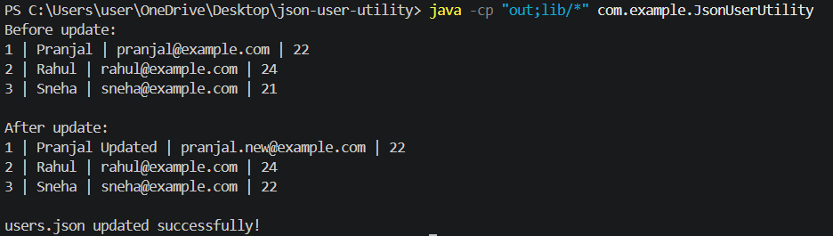

# JSON User Utility (Jackson)

Java utility that reads a JSON file of users, modifies entries, and writes back formatted JSON.

## Features
- User class with Jackson annotations
- Read JSON array into List<User> using ObjectMapper
- Modify user fields programmatically
- Write formatted JSON back to file
- I/O error handling

## Run
mvn compile exec:java -Dexec.mainClass="com.example.JsonUserUtility"

## Tech
Java 17, Maven, Jackson Databind

## Output

